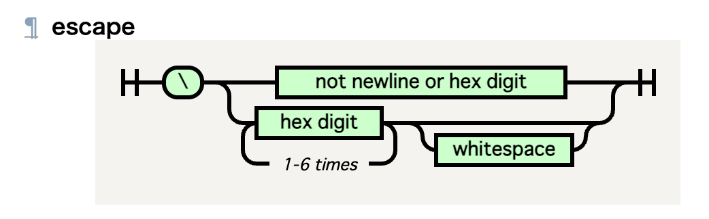
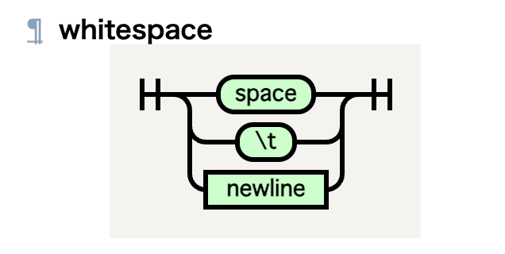
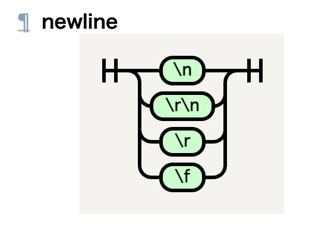

## 仕様書を読書しているとバグバウンティに役立つことがある
##### - Proton Mail の脆弱性を見つけた話 -
***
<br>

#### Ryoga.exe

---

<!-- .slide: style="text-align: left;" -->

## 自己紹介

<div style="display: flex; align-items: center; justify-content: space-between;">
  <div>
<h3>Ryoga.exe</h3>
     
- 筑波大学情報学群情報科学類 4 年
- フロントエンドの脆弱性が好き
- 最近は CSS Syntax Module Level 3 を読書
- X (Twitter)/mixi2: [@Ryoga_exe](https://x.com/Ryoga_exe)

  </div>

</div>

--

## CSS 遊びは楽しい

--

<iframe data-src="https://repos.ryoga.dev/css-monte-carlo-pi" data-preload style="background: white;" width="100%" height="500"></iframe>

--

<iframe data-src="/assets/2026/veryl-css/barcode.html" data-preload style="background: white;" width="100%" height="500" />

---

## CSS 遊びから CSS 犯罪へ

--

## Committing CSS Crimes

[](https://www.youtube.com/watch?v=INgS4IipEhU)

--

## これは何？

- おもしろスライド
- Lyra Rebane 氏による、CSS や SVG フィルタを悪用した攻撃
- セキュリティカンファレンスで発表

---

## 紹介されていたもの

--

<!-- .slide: data-background-image="proton-mail.jpg" -->

--

## メールクライアントにおけるプライバシー

--
<!-- .slide: data-auto-animate -->

`SECBTY-1128: Handle tabs inside styling content to prevent malicious attacks`

<div style="font-size: 0.8em">

```js
const CSS_URL = '((url|image-set)(\\(|&(#40|#x00028|lpar);))';
...

const UNESCAPE_CSS_ESCAPES_REGEX = /\\([0-9A-Fa-f]{1,6}) ?/g;
```

↓

```js
const CSS_URL = '((url|image-set)\\s*(\\(|&(#40|#x00028|lpar);))';
...

// Fixed to handle all CSS whitespace characters that can terminate escape sequences
const UNESCAPE_CSS_ESCAPES_REGEX = /\\([0-9A-Fa-f]{1,6})[ \t\n\r\f]?/g;
```

</div>

--

# 🤔

--

```js
const UNESCAPE_CSS_ESCAPES_REGEX = /\\([0-9A-Fa-f]{1,6})[ \t\n\r\f]?/g;
```

--

# 🤔

```sed
/\\([0-9A-Fa-f]{1,6})[ \t\n\r\f]?/g
```

`[ \t\n\r\f]` ……？

--

### おもむろに CSS Syntax Module Level 3 を読んでみる

CSS をどうパースするのかなどが書いてある

--
<!-- .slide: data-transition="fade-in fade-out" -->

### escape



--
<!-- .slide: data-transition="fade-in fade-out" -->

### whitespace



--
<!-- .slide: data-transition="fade-in fade-out" -->

### newline



--
<!-- .slide: data-auto-animate -->

# 🤔

```sed
/\\([0-9A-Fa-f]{1,6})[ \t\n\r\f]?/g
```

`[ \t\n\r\f]` ……？

--
<!-- .slide: data-auto-animate -->

# 🤔

```sed
/\\([0-9A-Fa-f]{1,6})[ \t\n\r\f]?/g
```


--

# 🤯

```sed
/\\([0-9A-Fa-f]{1,6})[ \t\n\r\f]?/g
```

→ `\r\n` (CRLF) が足りねぇ！
